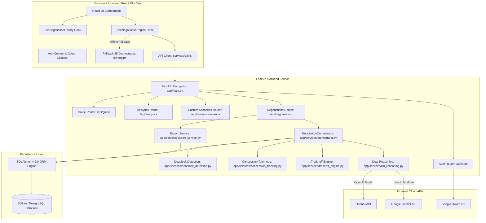
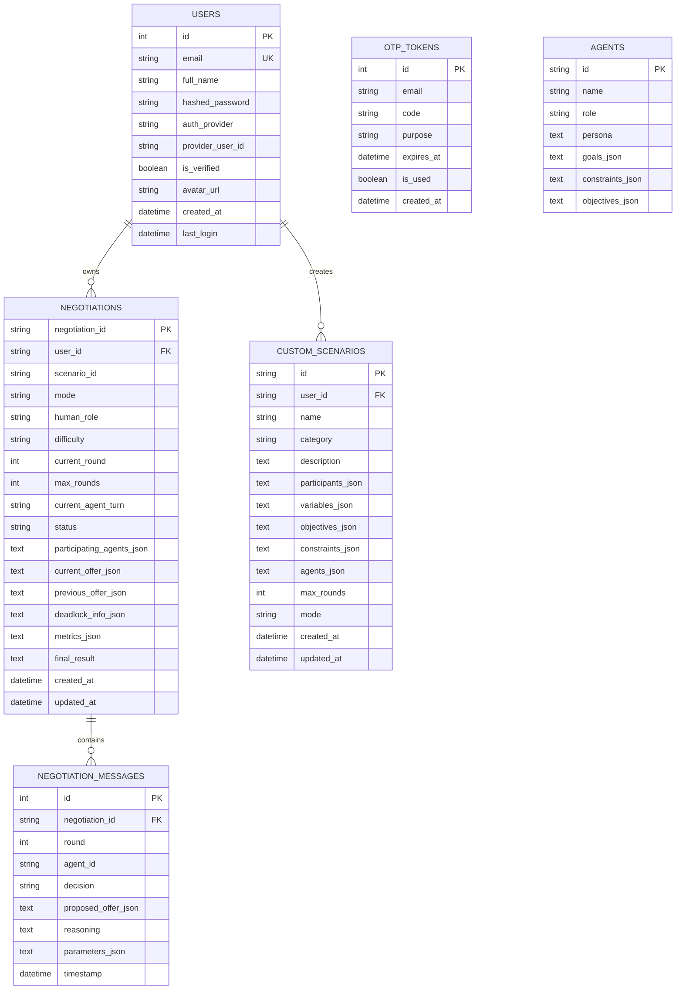
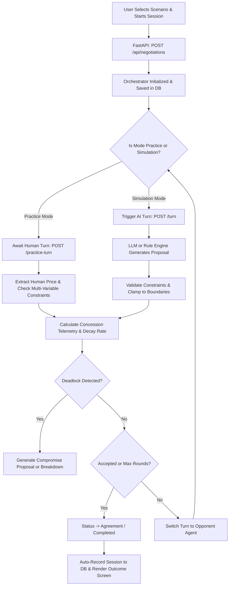

# System Architecture Document — NegoMind AI

## 1. Architecture Overview
NegoMind AI is built as a modular client-server web application comprised of:
1. **Frontend Presentation & Interaction Layer**: A modern Single Page Application (SPA) built with **React 19**, **Vite 8**, and **Tailwind CSS 3.4**, featuring GSAP animations and Lucide icons.
2. **Backend Services & Negotiation Engine Layer**: An asynchronous REST API built with **Python 3.10+** and **FastAPI**, containing the dual-pipeline reasoning engine (LLM vs. Deterministic Rule Engine), multi-variable trade-off calculations, concession telemetry math, and deadlock resolution state machines.
3. **Data Persistence Layer**: An ORM abstraction powered by **SQLAlchemy 2.0**, supporting local file-based **SQLite** (`negotiation.db`) and production **PostgreSQL** (Supabase/Neon), with automatic connection verification and sqlite failover.
4. **Client-Side Engine Fallback**: A mirrored JavaScript negotiation orchestrator located in `src/engine/` that allows offline simulation and interactive practice if the backend server is unreachable.



---

## 2. Repository Structure
The project repository is structured into distinct top-level directories:

```
Infosys-AI-Negotiation-main/
├── README.md                                    # Master project documentation
├── package.json                                 # Root build script invoking UI DESIGN build
├── vercel.json                                  # Root deployment routing
├── logo.png / logo-icon.png / favicon.svg       # Brand visual assets
├── Agile Documents/                             # Deliverable tracking workbooks
│   └── Agile_Final_Submission_Corrected.xlsm    # Product Backlog, Sprint Backlog, Retrospective
├── PROJECT_DOCUMENTATION/                       # Authoritative engineering documentation
│   ├── README.md
│   ├── prd.md
│   ├── architecture.md
│   ├── rules.md
│   ├── design.md
│   ├── memory.md
│   └── phases/
│       └── task.md
└── UI DESIGN/                                   # Full application root (Frontend & Backend)
    ├── package.json                             # Frontend dependencies & npm scripts
    ├── vite.config.js                           # Vite bundler configuration
    ├── tailwind.config.js                       # Tailwind CSS theme & plugin tokens
    ├── postcss.config.js                        # PostCSS configuration
    ├── vercel.json                              # Vercel SPA routing
    ├── .env.example                             # Frontend environment template
    ├── CONCESSION_ANALYTICS.md                 # Mathematical telemetry specifications
    ├── CONCESSION_TRACKING.md                  # Telemetry tracking implementation notes
    ├── TASK_3_TEST_MATRIX.md                   # Test execution matrix
    ├── dist/                                    # Production build artifact bundle
    ├── public/                                  # Static media assets & logos
    ├── src/                                     # React frontend application source
    │   ├── main.jsx                             # React DOM root entrypoint
    │   ├── App.jsx                              # Application router, state coordinator, layout
    │   ├── index.css                            # Global CSS styling & design system tokens
    │   ├── components/                          # Reusable UI widgets & modals
    │   │   ├── TopNavigation.jsx                # Global header & navigation links
    │   │   ├── Sidebar.jsx                      # Navigation drawer with StaggeredMenu
    │   │   ├── OutcomeScreen.jsx                # Agreement/deadlock outcome summary view
    │   │   ├── TugOfWarBargainingZone.jsx       # ZOPA bargaining range visualizer
    │   │   ├── PerformanceScorecard.jsx         # Practice mode evaluation scorecard
    │   │   ├── CinematicLoader.jsx              # Introductory animated loading screen
    │   │   ├── GuideBot.jsx                     # In-app AI guide assistant
    │   │   ├── dashboard/                       # Dashboard subcomponents
    │   │   ├── guide/                           # Contextual guide subcomponents
    │   │   └── scenarios/                       # Scenario selector & CustomScenarioBuilder
    │   ├── pages/                               # Page views
    │   │   ├── LandingPage.jsx                  # Public landing presentation
    │   │   ├── Dashboard.jsx                    # System dashboard & metrics overview
    │   │   ├── AgentConfiguration.jsx           # Participant & scenario setup
    │   │   ├── NegotiationArena.jsx             # Live turn feed & interaction arena
    │   │   ├── Analytics.jsx                    # Telemetry analytics & charts
    │   │   ├── Reports.jsx                      # Printable negotiation report view
    │   │   ├── NegotiationHistory.jsx           # Audit log, session detail & exports
    │   │   ├── AuthPage.jsx                     # Sign in, sign up, OTP modal
    │   │   └── AboutPage.jsx, ContactPage.jsx, PrivacyPage.jsx, TermsPage.jsx, PolicyPage.jsx
    │   ├── context/                             # React context providers
    │   │   └── AuthContext.jsx                  # User authentication state & token management
    │   ├── hooks/                               # Custom React hooks
    │   │   ├── useNegotiationEngine.js          # Backend API & fallback orchestrator hook
    │   │   ├── useNegotiationHistory.js         # Session persistence & history hook
    │   │   ├── useDashboardStats.js             # Metrics aggregation hook
    │   │   └── useGuideBot.js, useGuidedTour.js, useScenarioConfiguration.js
    │   ├── services/                            # Frontend API clients
    │   │   ├── api.js                           # Core REST client communicating with FastAPI
    │   │   ├── oauthService.js                  # Google OAuth popup & code exchange client
    │   │   ├── negotiationReport.js             # Summary report formatter
    │   │   ├── guideBotService.js               # Guide bot client
    │   │   └── scenarioService.js               # Scenario configuration helper
    │   ├── engine/                              # Client-side fallback negotiation engine
    │   │   ├── orchestrator.js                  # JS Orchestrator class
    │   │   ├── concessionTracking.js            # JS concession calculation
    │   │   ├── decisionLogic.js                 # JS rule-based decision trees
    │   │   ├── llmReasoning.js                  # JS mock reasoning logic
    │   │   ├── negotiationState.js              # JS state mutations
    │   │   ├── offer.js                         # JS offer factories
    │   │   └── agentInterface.js                # JS agent models
    │   └── data/                                # Static scenario fixtures
    │       ├── scenarios.js                     # 3 predefined scenarios
    │       └── dashboardData.js, guideKnowledgeBase.js
    └── backend/                                 # FastAPI Python Backend
        ├── requirements.txt                     # Backend Python dependencies
        ├── .env.example                         # Backend environment variables template
        ├── Procfile                             # Web server command for Render/Heroku
        ├── render.yaml                          # Render infrastructure as code spec
        ├── negotiation.db                       # Local SQLite primary/fallback database
        ├── test_negotiation.db                  # Automated test SQLite database
        ├── app/                                 # Backend application source
        │   ├── main.py                          # FastAPI application initialization & routes
        │   ├── config.py                        # Pydantic BaseSettings & environment config
        │   ├── database.py                      # SQLAlchemy database engine & session maker
        │   ├── api/                             # API routers
        │   │   ├── auth.py                      # Authentication, OTP, & OAuth routes
        │   │   ├── negotiations.py              # Negotiation sessions, turns, history & exports
        │   │   ├── scenarios.py                 # Preset scenario endpoints
        │   │   ├── custom_scenarios.py          # Custom Scenario Builder CRUD endpoints
        │   │   ├── agents.py                    # Agent profiles management
        │   │   ├── analytics.py                 # Dashboard and session telemetry endpoints
        │   │   ├── guide.py                     # Contextual AI guide bot endpoints
        │   │   └── chat.py                      # Chat message endpoints
        │   ├── models/                          # SQLAlchemy database entities
        │   │   ├── user.py                      # User & OTPToken models
        │   │   ├── agent.py                     # AgentModel
        │   │   ├── negotiation.py               # NegotiationModel
        │   │   ├── message.py                   # NegotiationMessageModel
        │   │   ├── custom_scenario.py           # CustomScenarioModel
        │   │   └── chat.py                      # ChatConversationModel & ChatMessageModel
        │   ├── schemas/                         # Pydantic request & response validation
        │   │   ├── auth.py                      # Sign-in, sign-up, OTP schemas
        │   │   ├── negotiation.py               # Session creation, turn, history, detail schemas
        │   │   ├── response.py                  # LLMStructuredResponse schema
        │   │   ├── tradeoff.py                  # Multi-attribute utility & trade-off schemas
        │   │   ├── custom_scenario.py           # Custom scenario CRUD schemas
        │   │   ├── agent.py                     # Agent profile schemas
        │   │   └── chat.py                      # Chat schemas
        │   └── services/                        # Business logic & computation engines
        │       ├── orchestrator.py              # NegotiationOrchestrator state machine
        │       ├── llm_reasoning.py             # Gemini/OpenAI prompt generation & clamping
        │       ├── decision_logic.py            # Rule-based decision logic & utility functions
        │       ├── offer_evaluation.py          # Value direction & target position resolver
        │       ├── concession_tracking.py       # Single-source mathematical concession telemetry
        │       ├── deadlock_detection.py        # Stagnation detection & resolution proposals
        │       ├── tradeoff_engine.py           # Multi-variable attribute utility & Pareto engine
        │       ├── practice_service.py          # NLP parsing, difficulty levels, coaching hints
        │       ├── export_service.py            # ReportLab PDF, CSV & JSON sanitized exports
        │       ├── analytics_service.py         # Summary metrics & dashboard aggregations
        │       ├── auth_service.py              # PBKDF2 hashing, OTP generation, token decode
        │       ├── email_service.py             # SMTP email dispatcher
        │       ├── guide_service.py             # Knowledge-base search assistant
        │       └── negotiation_service.py       # Session factory & agent bootstrapping
        └── tests/                               # Pytest automated test suite (18 modules, 133 tests)
```

---

## 3. Technology Stack

| Technology | Purpose | Location of Use | Evidence | Verified Version |
|---|---|---|---|---|
| **Python** | Backend runtime environment | `backend/` | `backend/runtime.txt`, `Procfile` | 3.10+ (Verified on 3.13) |
| **FastAPI** | Asynchronous REST API framework | `backend/app/main.py` | `backend/requirements.txt` | 0.110.0+ |
| **Uvicorn** | ASGI server | `backend/app/main.py` | `backend/Procfile` | 0.28.0+ |
| **Pydantic / Pydantic Settings** | Request/response validation & config | `backend/app/schemas/`, `config.py` | `backend/requirements.txt` | 2.6.4+ / 2.2.1+ |
| **SQLAlchemy** | Database ORM & session management | `backend/app/database.py`, `models/` | `backend/requirements.txt` | 2.0.28+ |
| **ReportLab** | Server-side programmatic PDF generation | `backend/app/services/export_service.py` | `backend/requirements.txt` | 4.1.0+ |
| **Google GenAI / GenerativeAI** | Cloud LLM reasoning integration | `backend/app/services/llm_reasoning.py` | `backend/requirements.txt` | `google-genai` / `google-generativeai` |
| **OpenAI SDK** | Secondary LLM provider integration | `backend/app/services/llm_reasoning.py` | `backend/requirements.txt` | 1.14.0+ |
| **Pytest / Pytest-Asyncio** | Automated testing suite | `backend/tests/` | 133 passed tests | 8.1.1+ / 0.23.5+ |
| **React** | Component-based UI framework | `UI DESIGN/src/` | `package.json` | 19.2.8 |
| **Vite** | Modern frontend build tool | `UI DESIGN/vite.config.js` | `package.json` | 8.2.2 |
| **Tailwind CSS** | Utility-first styling framework | `UI DESIGN/tailwind.config.js` | `package.json` | 3.4.19 |
| **GSAP** | Motion animations & transitions | `UI DESIGN/src/components/` | `package.json` | 3.15.0 |
| **Lucide React** | Application icon library | `UI DESIGN/src/` | `package.json` | 1.34.0 |
| **Oxlint** | High-performance JS/JSX linter | `UI DESIGN/.oxlintrc.json` | `package.json` | 1.79.0 |

---

## 4. Frontend Architecture

### 4.1 Entry Point & Routing
- Entry Point: `src/main.jsx` mounts the root component into `#root` in `index.html`.
- Application State & Router: `src/App.jsx` acts as the primary layout coordinator. It maintains the current `activePage` state (`Landing`, `Dashboard`, `Scenarios`, `Configure Agents`, `Negotiation Arena`, `Analytics`, `Reports`, `Negotiation History`, `AuthPage`, `About`, `ContactPage`, etc.).
- OAuth Callback Interceptor: Lines 30–40 of `App.jsx` intercept OAuth popup redirects (`/oauth/callback`, `/auth/callback`, or URL parameters with `code=` / `token=`) and render `<OAuthCallbackHandler />` before loading the standard interface.

### 4.2 State Management & Hooks
- `AuthContext.jsx`: Provides authenticated user profile, session token (`localStorage.getItem("token")`), login, signup, and logout actions.
- `useNegotiationEngine.js`: Manages the lifecycle of an active negotiation session. Tries the backend API first via `createNegotiationSession`; if backend is down, initializes a client-side `Orchestrator` instance from `src/engine/orchestrator.js`. Exposes `start()`, `step()`, `run()`, `submitPracticeTurn()`, `fetchHint()`, and `reset()`.
- `useNegotiationHistory.js`: Manages local and remote history synchronization, maintaining a cache in `localStorage` under `negotiation_platform_history_v1` and syncing completed sessions to the backend database via `recordNegotiationSession`.

### 4.3 Key Components
- `NegotiationArena.jsx`: The interactive negotiation command center. Features live turn transcript feeds, stance indicators, round metrics, reasoning overlays, and input controls for human turns.
- `OutcomeScreen.jsx`: Summarizes negotiation results, agreement pricing, utility satisfaction, round counts, and concession graphs upon session completion.
- `TugOfWarBargainingZone.jsx`: Dynamic visual bargaining gauge showing current offers relative to the buyer's maximum ceiling and vendor's minimum floor.
- `CustomScenarioBuilder.jsx`: Modal form allowing creation, updating, duplication, and launching of custom multi-variable scenarios.
- `NegotiationHistory.jsx`: Full-featured audit view with search, outcome filters, date filters, sorting, server/local pagination, session detail modal, and direct downloads for PDF, CSV, and JSON exports.

---

## 5. Backend Architecture

### 5.1 FastAPI Application Initialization
Located in `backend/app/main.py`:
- Initializes FastAPI instance with title `"AI Negotiation Engine API"`, version `"1.0.0"`.
- Calls `init_db()` on startup to create tables (`Base.metadata.create_all`) and run automatic SQLite schema migrations (adding columns `mode`, `human_role`, `user_id`, `difficulty`, `metrics_json`, `provider_user_id` if missing).
- Mounts `CORSMiddleware` configured with origins from `settings.cors_origins_list`.
- Registers routers: `auth`, `agents`, `negotiations`, `scenarios`, `custom_scenarios`, `analytics`, `guide`, and `chat`.
- Defines global exception handler logging tracebacks and returning clean JSON 500 error objects.

### 5.2 Service Layer Breakdown
1. `orchestrator.py`: Implements `NegotiationOrchestrator`, the stateful multi-agent turn execution engine.
2. `llm_reasoning.py`: Handles Google Gemini and OpenAI prompt templates, parses structured JSON, and enforces constraint guardrails (`validate_agent_constraints`).
3. `decision_logic.py`: Evaluates utility functions and deterministic decision trees for Accept, Reject, and Counter actions.
4. `offer_evaluation.py`: Resolves authoritative target positions, calculates value direction, and determines offer acceptability.
5. `concession_tracking.py`: Mathematical telemetry engine computing step concession amount, decay rate, velocity, remaining capacity, and ZOPA overlap.
6. `deadlock_detection.py`: Tracks price stagnation across rounds and evaluates compromise proposals.
7. `tradeoff_engine.py`: Evaluates multi-issue bundles, calculates normalized utility, and classifies trade-offs.
8. `practice_service.py`: Parses human natural language offers via regex/LLM, evaluates adaptive difficulty levels, generates tactical hints, and computes performance scorecards.
9. `export_service.py`: Builds ReportLab PDF documents, generates sanitized CSV files with formula injection protection, and strips sensitive credentials from JSON exports.
10. `auth_service.py`: Implements PBKDF2 password hashing, 6-digit OTP verification, bearer session token generation, and Google OAuth code exchange.

---

## 6. Negotiation Architecture

### 6.1 Session Lifecycle & State Machine
Every negotiation progresses through well-defined states:
- `active`: In-progress session awaiting turn execution.
- `agreement` / `accepted`: Successful conclusion where an offer was accepted.
- `rejected`: Explicit rejection terminating the session.
- `completed`: Maximum configured rounds elapsed without agreement.
- `deadlock`: Stagnation detected across consecutive rounds.
- `breakdown`: Unresolvable conflict where constraints do not overlap or compromise was rejected.

### 6.2 Turn Execution Flow
```mermaid
sequenceDiagram
    autonumber
    actor Participant as Active Agent / Human
    participant Orch as NegotiationOrchestrator
    participant Evaluator as Offer Evaluation & Utility
    participant Engine as LLM / Rule Engine
    participant Guard as Constraint & Concession Guardrail
    participant Concession as Concession Telemetry
    participant Deadlock as Deadlock Engine
    participant DB as SQLite / PostgreSQL

    Participant->>Orch: Trigger Turn / Submit Offer
    Orch->>Evaluator: Evaluate opponent offer & utility score
    Orch->>Engine: Generate proposed action & counteroffer
    Engine-->>Guard: Raw Proposal (JSON)
    Guard->>Guard: Validate financial limits & clamp out-of-bounds prices
    Guard-->>Orch: Validated Response (accept / counter / reject)
    Orch->>Concession: Calculate step size, decay rate & remaining capacity
    Orch->>Deadlock: Check for stagnation or boundary breakdown
    alt Deadlock Detected & Feasible
        Orch->>Orch: Attempt resolution proposal within ZOPA
    else Accepted
        Orch->>Orch: Transition status to 'agreement'
    else Max Rounds Reached
        Orch->>Orch: Transition status to 'completed'
    end
    Orch->>DB: Persist turn message and session state
    Orch-->>Participant: Return updated state and turn log
```

---

## 7. Database Architecture

### 7.1 Database Engine Configuration
- Primary configuration: `settings.DATABASE_URL` in `backend/app/config.py`.
- Engine factory: `backend/app/database.py` normalizes `postgres://` URLs to `postgresql://` and configures connection pooling for PostgreSQL (`pool_size=10, max_overflow=20, pool_recycle=300`).
- Automatic Fallback: If external database connection fails, logs warning and binds to `sqlite:///./negotiation.db` with `connect_args={"check_same_thread": False}`.

### 7.2 Models & Schema Entities



---

## 8. API Architecture (Endpoint Inventory)

| HTTP Method | Route | Purpose | Auth Required | Request Schema | Response Schema | Source File | Status |
|---|---|---|---|---|---|---|---|
| `GET` | `/` | Service health & metadata | No | None | Dict | `app/main.py` | Verified |
| `GET` | `/api/health` | Health & masked DB status | No | None | Dict | `app/main.py` | Verified |
| `GET` | `/api/health/llm` | Diagnostic LLM connectivity check | No | None | Dict | `app/main.py` | Verified |
| `GET` | `/api/health/llm/models` | List supported LLM models | No | None | Dict | `app/main.py` | Verified |
| `GET` | `/api/settings/mode` | Get current reasoning engine mode | No | None | Dict | `app/main.py` | Verified |
| `POST` | `/api/settings/mode` | Toggle engine mode (Gemini vs Normal) | No | Dict | Dict | `app/main.py` | Verified |
| `POST` | `/api/auth/signup` | Register user & dispatch OTP | No | `UserSignUp` | `OTPRequiredResponse` | `app/api/auth.py` | Verified |
| `POST` | `/api/auth/verify-otp` | Verify 6-digit OTP code | No | `OTPVerify` | `AuthResponse` | `app/api/auth.py` | Verified |
| `POST` | `/api/auth/resend-otp` | Resend fresh OTP | No | `OTPResend` | `OTPRequiredResponse` | `app/api/auth.py` | Verified |
| `POST` | `/api/auth/signin` | Sign in with email and password | No | `UserSignIn` | `AuthResponse` | `app/api/auth.py` | Verified |
| `GET` | `/api/auth/google/login` | Generate Google OAuth consent URL | No | None | Dict / Redirect | `app/api/auth.py` | Verified |
| `GET` | `/api/auth/google/callback`| Handle Google OAuth code callback | No | Query params | Redirect | `app/api/auth.py` | Verified |
| `GET` | `/api/scenarios` | List preset negotiation scenarios | No | None | `List[Dict]` | `app/api/scenarios.py` | Verified |
| `GET` | `/api/scenarios/{id}` | Get preset scenario details | No | None | Dict | `app/api/scenarios.py` | Verified |
| `GET` | `/api/agents` | List active agent profiles | No | None | `List[AgentResponse]` | `app/api/agents.py` | Verified |
| `POST` | `/api/agents` | Create custom agent profile | No | `AgentCreate` | `AgentResponse` | `app/api/agents.py` | Verified |
| `POST` | `/api/negotiations` | Create new negotiation session | Optional | `NegotiationCreate` | `NegotiationStateResponse` | `app/api/negotiations.py` | Verified |
| `GET` | `/api/negotiations` | List user historical summaries | Optional | None | `List[NegotiationSummary]` | `app/api/negotiations.py` | Verified |
| `GET` | `/api/negotiations/history`| List authenticated user history | **Yes** (Bearer) | Query params | `NegotiationHistoryListResponse` | `app/api/negotiations.py` | Verified |
| `GET` | `/api/negotiations/history/export` | Export all history (CSV/JSON/PDF) | **Yes** (Bearer) | Query params | File Response | `app/api/negotiations.py` | Verified |
| `POST` | `/api/negotiations/record` | Persist completed session record | Optional | `NegotiationRecordCreate` | `NegotiationDetailResponse` | `app/api/negotiations.py` | Verified |
| `GET` | `/api/negotiations/{id}` | Get active negotiation state | Optional/Owner | None | `NegotiationStateResponse` | `app/api/negotiations.py` | Verified |
| `GET` | `/api/negotiations/{id}/detail` | Get complete read-only detail | **Yes** (Owner) | None | `NegotiationDetailResponse` | `app/api/negotiations.py` | Verified |
| `GET` | `/api/negotiations/{id}/export` | Export single session (PDF/CSV/JSON) | **Yes** (Owner) | Query params | File Response | `app/api/negotiations.py` | Verified |
| `POST` | `/api/negotiations/{id}/turn` | Run active agent AI turn | No | None | Dict | `app/api/negotiations.py` | Verified |
| `POST` | `/api/negotiations/{id}/practice-turn` | Submit human offer in Practice Mode | No | `PracticeTurnRequest` | `NegotiationStateResponse` | `app/api/negotiations.py` | Verified |
| `POST` | `/api/negotiations/{id}/hint` | Fetch strategic tactical hint | No | None | `HintResponse` | `app/api/negotiations.py` | Verified |
| `POST` | `/api/negotiations/{id}/parse-message`| Parse natural language to offer | No | `ParseMessageRequest` | `ParseMessageResponse` | `app/api/negotiations.py` | Verified |
| `GET` | `/api/negotiations/{id}/metrics` | Live concession telemetry & utility | No | None | Dict | `app/api/negotiations.py` | Verified |
| `POST` | `/api/negotiations/{id}/end` | End session & get scorecard | No | Query params | `NegotiationScorecard` | `app/api/negotiations.py` | Verified |
| `POST` | `/api/negotiations/{id}/run` | Run session to completion | No | None | `NegotiationStateResponse` | `app/api/negotiations.py` | Verified |
| `GET` | `/api/negotiations/{id}/history` | Get turn conversation history | No | None | `List[OfferLog]` | `app/api/negotiations.py` | Verified |
| `GET` | `/api/custom-scenarios` | List custom scenarios | Optional | Query params | `List[CustomScenarioResponse]` | `app/api/custom_scenarios.py` | Verified |
| `POST` | `/api/custom-scenarios` | Create custom scenario | Optional | `CustomScenarioCreateRequest` | `CustomScenarioResponse` | `app/api/custom_scenarios.py` | Verified |
| `GET` | `/api/custom-scenarios/{id}` | Get custom scenario by ID | No | None | `CustomScenarioResponse` | `app/api/custom_scenarios.py` | Verified |
| `PUT` | `/api/custom-scenarios/{id}` | Update custom scenario | Optional/Owner | `CustomScenarioUpdateRequest` | `CustomScenarioResponse` | `app/api/custom_scenarios.py` | Verified |
| `POST` | `/api/custom-scenarios/{id}/duplicate` | Duplicate custom scenario | Optional | None | `CustomScenarioResponse` | `app/api/custom_scenarios.py` | Verified |
| `DELETE` | `/api/custom-scenarios/{id}` | Delete custom scenario | Optional/Owner | None | Dict | `app/api/custom_scenarios.py` | Verified |
| `POST` | `/api/custom-scenarios/{id}/start` | Start negotiation from custom scenario | Optional | Query params | Dict | `app/api/custom_scenarios.py` | Verified |
| `GET` | `/api/analytics/dashboard` | Dashboard metrics for user | Optional | Query params | Dict | `app/api/analytics.py` | Verified |
| `POST` | `/api/guide/query` | Ask in-app AI guide bot | No | Dict | Dict | `app/api/guide.py` | Verified |

---

## 9. Authentication Architecture
1. **Password Authentication**: Passwords hashed using PBKDF2 with SHA-256 and unique 16-byte random salts across 100,000 iterations (`app/services/auth_service.py`).
2. **OTP Verification**: Dispatches 6-digit cryptographic verification codes stored in `otp_tokens` with 10-minute expiry.
3. **Session Tokens**: Issue bearer tokens in format `nego_token_{user_id}_{random_bytes}`. Verified via `get_user_from_header` helper.
4. **Google OAuth 2.0**: Implements authorization code grant flow with cryptographic state parameters, exchanges code for user profile, and safely links existing accounts by email address.

---

## 10. Reporting and History Architecture
- **Session Persistence**: Sessions completed in the frontend are auto-persisted via `recordNegotiationSession` calling `POST /api/negotiations/record`. Turn messages are stored sequentially in `negotiation_messages`.
- **Ownership Verification**: `verify_negotiation_ownership` checks whether the requesting user matches `session.user_id` or user email. Mismatched users receive `403 Forbidden`.
- **Export Engines**:
  - **PDF Export**: Programmatic document construction via ReportLab Platypus (`SimpleDocTemplate`, `Table`, `ParagraphStyle`), rendering session badges, KPIs, participant parameters, and chronological turn tables.
  - **CSV Export**: Sanitizes every cell with `sanitize_csv_cell` to prevent spreadsheet formula injection (DDE attacks).
  - **JSON Export**: Strips forbidden keys (`hashed_password`, `token`, `secret`, `api_key`) and returns structured JSON.

---

## 11. Data Flow

### 11.1 Negotiation Execution Flow


### 11.2 History Retrieval & Export Flow
```mermaid
flowchart TD
    User([Authenticated User]) -->|GET /api/negotiations/history| API[FastAPI Negotiations API]
    API --> AuthCheck{Bearer Token Valid?}
    AuthCheck -->|No| Unauthorized[401 Unauthorized]
    AuthCheck -->|Yes| QueryDB[Query DB for User Sessions with Filters]
    QueryDB --> ReturnList[Return Paginated Sessions List]
    User -->|GET /api/negotiations/{id}/export?format=pdf| ExportAPI[Export Endpoint]
    ExportAPI --> OwnerCheck{User Owns Session?}
    OwnerCheck -->|No| Forbidden[403 Forbidden]
    OwnerCheck -->|Yes| FormatCheck{Export Format}
    FormatCheck -->|PDF| ReportLab[Generate ReportLab PDF Stream]
    FormatCheck -->|CSV| CSVBuilder[Sanitize Cells & Build CSV]
    FormatCheck -->|JSON| JSONBuilder[Sanitize Dict & Output JSON]
    ReportLab --> Download[Stream File Attachment to Browser]
    CSVBuilder --> Download
    JSONBuilder --> Download
```

---

## 12. Deployment Architecture
- **Frontend Hosting**: Vercel (Vite React SPA, build output `dist`, routed via `UI DESIGN/vercel.json` rewrites `source: "/(.*)", destination: "/index.html"`).
- **Backend Hosting**: Render / Heroku Web Service, built via `backend/render.yaml` or `backend/Procfile` executing `web: uvicorn app.main:app --host 0.0.0.0 --port $PORT`.
- **Database**: Cloud PostgreSQL (Supabase / Neon) via `DATABASE_URL` environment variable; automatic fallback to local SQLite for self-contained hosting.
- **Environment Variables**:
  - Frontend: `VITE_API_BASE_URL`
  - Backend: `LLM_PROVIDER`, `LLM_API_KEY`, `LLM_MODEL`, `DATABASE_URL`, `PORT`, `HOST`, `CORS_ORIGINS`, `SMTP_SERVER`, `SMTP_PORT`, `SMTP_USERNAME`, `SMTP_PASSWORD`, `SMTP_FROM_EMAIL`, `GOOGLE_CLIENT_ID`, `GOOGLE_CLIENT_SECRET`, `GOOGLE_REDIRECT_URI`, `GITHUB_CLIENT_ID`, `GITHUB_CLIENT_SECRET`.

---

## 13. Testing Architecture
The backend includes a comprehensive test suite executed with `pytest`:
- Total Test Modules: 18 test files in `backend/tests/`.
- Total Passing Tests: **133 passed (100% pass rate)**.
- Test Modules Breakdown:
  1. `test_agents.py` (3 tests): Agent profile model and API endpoints.
  2. `test_analytics_and_guide.py` (3 tests): Session analytics and Guide bot API.
  3. `test_auth_avatar.py` (4 tests): User registration, avatar fallbacks, and password verification.
  4. `test_chat_api.py` (8 tests): Chat conversation models and endpoints.
  5. `test_concession_tracking.py` (13 tests): Concession magnitude, step %, decay rate, capacity, and ZOPA.
  6. `test_custom_scenarios.py` (4 tests): Custom Scenario Builder CRUD and launch flows.
  7. `test_google_oauth.py` (11 tests): Google OAuth code exchange and account linking.
  8. `test_health.py` (7 tests): Diagnostics, health checks, and engine mode switches.
  9. `test_interactive_practice.py` (16 tests): Human turns, difficulty scaling, hints, and scorecards.
  10. `test_milestone3.py` (10 tests): Orchestrator turns, deadlock detection, and termination logic.
  11. `test_multi_round_vendor_pricing.py` (4 tests): Multi-round simulation across rounds.
  12. `test_negotiation.py` (2 tests): Negotiation persistence and message queries.
  13. `test_negotiation_history.py` (13 tests): History listing, detail views, PDF/CSV/JSON exports, ownership authorization (403), injection protection, and unauthenticated rejections (401).
  14. `test_offer_evaluation.py` (6 tests): Value direction, target position resolver, acceptability.
  15. `test_orchestrator.py` (1 test): Orchestrator initialization and turn transitions.
  16. `test_practice_mode.py` (13 tests): Practice mode baselines and human participant integration.
  17. `test_reasoning.py` (4 tests): LLM prompt generation and constraint clamping guardrails.
  18. `test_tradeoff_engine.py` (12 tests): Multi-attribute utility, Pareto trade-off detection, issue weighting.

---

## 14. Security Architecture
1. **Authentication Boundary**: Protected endpoints require a valid `Authorization: Bearer <token>` header. Missing or expired tokens return HTTP 401.
2. **Authorization & Multi-Tenancy**: Private sessions check ownership before returning transcripts or export files (`verify_negotiation_ownership`). Mismatched users receive HTTP 403.
3. **Sensitive Data Sanitization**:
   - `mask_secrets` masks database passwords and API keys on public health diagnostics.
   - `sanitize_session_for_export` strips passwords, tokens, and API keys from JSON files.
   - `sanitize_csv_cell` defends against formula injection attacks in spreadsheet exports.
4. **Trust Boundary**: Incoming offers from both humans and LLMs are treated as untrusted and clamped against hard agent boundary limits before updating session state.

---

## 15. Known Architectural Issues & Discrepancies
1. **Demo OTP Returned in API Responses**: In `backend/app/api/auth.py`, endpoints `/api/auth/signup`, `/api/auth/signin`, and `/api/auth/resend-otp` return `demo_otp` in the JSON response body. While convenient for demonstration and automated testing, this allows anyone to bypass email verification in production.
2. **Dual Duplicate Negotiation Engines**: An identical negotiation engine is implemented in Python (`backend/app/services/`) and in JavaScript (`UI DESIGN/src/engine/`). Maintaining two parallel engines risks logic drift. The Python backend is the authoritative source of truth.
3. **Database Migration Approach**: Schema migrations currently use dynamic `ALTER TABLE` commands inside `init_db()` in `app/main.py` rather than a standard migration framework such as Alembic.
4. **Agile Voice Feature Missing**: Agile deliverable `US-M4-07` ("Voice AI Interactive Practice Mode") is documented in planning workbooks but has no implementation in frontend or backend code.

---

## 16. Architecture Decisions (ADR Summary)
- **ADR-001 (Dual Reasoning Mode)**: Implemented dual reasoning (Google Gemini LLM vs. Deterministic Rule Engine) to ensure full functionality without mandatory external API keys.
- **ADR-002 (Single-Source Concession Math)**: Centralized all concession telemetry in `concession_tracking.py` to prevent discrepancies between evaluation, orchestrator, and UI dashboards.
- **ADR-003 (Backend Ownership for History & Export)**: Enforced user ownership and server-side ReportLab PDF generation directly in FastAPI to ensure auditability and security compliance.
- **ADR-004 (Graceful SQLite Fallback)**: Configured database engine to fall back to local SQLite if cloud PostgreSQL is unreachable, guaranteeing local development zero-setup friction.
