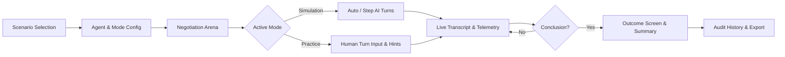

# UI/UX and Product Design Document — NegoMind AI

## 1. Design Principles
NegoMind AI’s visual interface is designed to evoke a modern, high-focus enterprise decision-making cockpit. The user experience is governed by four foundational design principles:
1. **Clarity Over Clutter**: Complex multi-variable data, concession telemetry, and multi-round transcripts are presented with clear visual hierarchy, using typography and badges to distinguish agents and outcomes.
2. **Deterministic Confidence & Real-Time Feedback**: Users always know whose turn it is, what decision was made, what the reasoning was, and whether constraints were enforced. Stance badges and live ZOPA indicators update dynamically.
3. **Restrained, Premium Dark Aesthetics**: A matte pitch-black and deep charcoal surface system with subtle glows prevents visual fatigue during extended multi-round sessions.
4. **Resilient Data States**: Every view seamlessly handles empty states, loading skeletons, error notices with retry prompts, and access-denied warnings.

---

## 2. Existing Design System

### 2.1 Color Palette Tokens (from `tailwind.config.js`)

| Token Name | Hex Value | Purpose & Usage |
|---|---|---|
| `bg` / `header` / `sidebar` | `#0C0C0F` | Outer matte pitch-black background and sticky navigation header |
| `mainPanel` | `#17161B` | Elevated central container for page workspaces |
| `card` | `#201F25` | Standard inset card containers and metric tiles |
| `cardAlt` | `#25242C` | Secondary card surface and interactive dropdown lists |
| `border` | `#2A2931` | Default structural border and dividing line |
| `borderSubtle` | `#302F39` | Subtle component outline and divider |
| `borderGlow` | `#3D3B48` | Focused state border and interactive boundary highlight |
| `primary` / `primaryBright` | `#F8FAFC` / `#FFFFFF` | Primary headers, active labels, brand white text |
| `textSecondary` | `#A1A1AA` | Body copy, secondary descriptions, metadata labels |
| `textMuted` | `#71717A` | Inactive icons, timestamps, placeholder values |
| `success` / `successBright` | `#10B981` / `#34D399` | Agreements, accepted offers, positive decay, Emerald badges |
| `warning` / `warningBright` | `#F59E0B` / `#FBBF24` | Counteroffers, pending turns, moderate decay rates |
| `danger` | `#EF4444` | Rejections, deadlocks, breakdowns, error alerts |
| `azure` / `azureBright` | `#3B82F6` / `#60A5FA` | Simulation mode badges, information hints, links |

### 2.2 Typography
- **Headings & Titles**: `Plus Jakarta Sans`, sans-serif (Weights: 600 Semi-Bold, 700 Bold, 800 Extra Bold).
- **Body & Controls**: `Inter`, system-ui, sans-serif (Weights: 400 Regular, 500 Medium).
- **Numeric Data & Code**: `JetBrains Mono`, monospace (Used for price tags, currency values, round counters).

### 2.3 Surface Elevation & Shadows
- **Card Shadow**: `0 4px 20px -2px rgba(0, 0, 0, 0.4)`
- **Hover Elevation**: `0 12px 32px -4px rgba(0, 0, 0, 0.5), 0 0 0 1px rgba(99, 102, 241, 0.35)`
- **Success Glow**: `0 0 16px rgba(16, 185, 129, 0.22)`

### 2.4 Buttons & Controls
- **Primary Action**: Emerald gradient button (`bg-emerald-500 hover:bg-emerald-400 text-black font-semibold rounded-xl px-5 py-2.5 transition-all`).
- **Secondary Action**: Dark border button (`bg-[#201F25] hover:bg-[#25242C] border border-[#2A2931] text-[#F8FAFC] rounded-xl px-4 py-2`).
- **Danger Action**: Rose accent button (`bg-rose-500/10 hover:bg-rose-500/20 border border-rose-500/40 text-rose-400`).
- **Form Inputs**: Dark input fields (`bg-[#121115] border border-[#2A2931] focus:border-emerald-500 rounded-xl px-4 py-2.5 text-[#F8FAFC]`).

---

## 3. Existing Pages & Navigation

### 3.1 Page Inventory
1. **Landing Page (`src/pages/LandingPage.jsx`)**: Public showcase presenting platform capabilities, interactive demo tabs, feature highlights, and call-to-action buttons.
2. **Dashboard (`src/pages/Dashboard.jsx`)**: High-level command center displaying total simulations, win rates, active negotiation summaries, recent history cards, and quick actions.
3. **Negotiation Scenarios (`src/components/scenarios/NegotiationScenariosView.jsx`)**: Grid selector displaying standard preset scenarios (Vendor Pricing, Job Offer, Project Budget) and saved custom scenarios with direct launch actions.
4. **Custom Scenario Builder (`src/components/scenarios/CustomScenarioBuilder.jsx`)**: Modal dialog for creating, duplicating, and configuring participants, variables, and constraints.
5. **Agent Configuration (`src/pages/AgentConfiguration.jsx`)**: Role cards configuring negotiation mode (Simulation vs. Practice), human role selection, difficulty level (Beginner, Intermediate, Advanced, Expert), and round limits.
6. **Negotiation Arena (`src/pages/NegotiationArena.jsx`)**: Active execution view with chat transcript feed, AI reasoning modal overlays, stance indicators, Tug-of-War ZOPA gauge, and human turn submission forms.
7. **Outcome Screen (`src/components/OutcomeScreen.jsx`)**: Modal presentation upon negotiation completion detailing final settlement terms, rounds elapsed, concession trajectory, and per-agent satisfaction.
8. **Reports (`src/pages/Reports.jsx`)**: Structured executive summary report with print-to-PDF stylesheet support.
9. **Analytics (`src/pages/Analytics.jsx`)**: Concession telemetry charts, decay velocity curves, and scenario breakdown metrics.
10. **Negotiation History (`src/pages/NegotiationHistory.jsx`)**: Audit log table of past sessions with search, multi-variable filters, session detail modal, and download buttons (PDF, CSV, JSON).
11. **Authentication (`src/pages/AuthPage.jsx`)**: Tabbed login and registration modal with 6-digit OTP verification and Google OAuth button.
12. **Informational Pages**: About (`AboutPage.jsx`), Contact (`ContactPage.jsx`), Privacy (`PrivacyPage.jsx`), Terms (`TermsPage.jsx`), Policy (`PolicyPage.jsx`).

---

## 4. Negotiation UX Flow

1. **Setup**: User selects a scenario and chooses between autonomous AI Simulation or interactive Practice Mode.
2. **Arena Execution**:
   - The chat feed renders turns with agent avatars, decision badges (`OFFER`, `COUNTER`, `ACCEPT`, `REJECT`), offer amounts, and natural-language justifications.
   - The *Tug-of-War Bargaining Zone* visually displays where the current offer sits relative to the Buyer's maximum ceiling and Seller's minimum floor.
3. **Practice Interaction**:
   - The human participant can enter natural language messages or adjust numeric price sliders.
   - Users can request real-time strategic advice via the *Tactical Hint* button.
4. **Conclusion**:
   - On agreement, celebration indicators and settlement metrics are displayed.
   - On deadlock, the reason for breakdown and compromise attempt logs are presented.

---

## 5. Negotiation History UX (Verified vs. Proposed)

### 5.1 Existing Implemented UX (`src/pages/NegotiationHistory.jsx`)
- **Header & Action Bar**: Search input bar, filter dropdowns (Mode: All/Simulation/Practice; Outcome: All/Agreement/Deadlock/In Progress; Date Range: All/Today/7 Days/30 Days), Sort toggle (Newest/Oldest), and "Export All (CSV)" button.
- **History Table**: Tabular layout rendering:
  - Scenario Name & ID
  - Mode Badge (`SIMULATION` in Sky Blue, `PRACTICE` in Indigo)
  - Outcome Badge (`Agreement` in Emerald, `Deadlock` in Rose)
  - Final Settlement Price (Currency formatted)
  - Rounds elapsed vs Max rounds
  - Timestamp (Relative & ISO format)
  - Actions: **View Details** button, **PDF** download icon, **CSV** download icon, **JSON** download icon.
- **Session Detail Modal**: Read-only overlay rendering:
  - Header summary with scenario title, status, and settlement amount
  - Tabbed or linear chronological transcript view (`round 1, 2, 3...`)
  - Agent reasoning callouts
  - Download buttons directly in modal header.
- **Empty State**: Renders clean illustration with "No negotiation sessions found" prompt and a button to launch a new session.
- **Loading State**: Renders animated pulsating skeleton cards.

### 5.2 Proposed UX Enhancements (Clearly Labeled as PROPOSED)
- **[PROPOSED UX-01] Visual Pareto Frontier Graph**: In the session detail modal, render an interactive 2D canvas displaying the Pareto efficiency frontier of all multi-variable offers made during the session.
- **[PROPOSED UX-02] Bulk Checkbox Selection**: Allow users to select multiple specific sessions via table checkboxes and click "Export Selected (ZIP / CSV)".
- **[PROPOSED UX-03] Transcript Audio Playback**: Provide an audio playback control synthesizing the turn-by-turn negotiation dialog with distinct text-to-speech voices for each agent persona.

---

## 6. Responsive Behavior
- **Desktop (1280px+)**: Multi-column layout with sidebar navigation, side-by-side agent cards, and full-width telemetry charts.
- **Tablet (768px – 1024px)**: Collapsible sidebar into a drawer menu; two-column grid transitions into stacked cards.
- **Mobile (< 768px)**: Single-column linear layout; bottom fixed action bar for human turn inputs; tables switch to responsive cards.

---

## 7. Accessibility (A11y)
- **Keyboard Navigation**: Interactive buttons and inputs include focus rings (`focus:ring-2 focus:ring-emerald-500`).
- **Semantic HTML**: Proper use of `<header>`, `<nav>`, `<main>`, `<section>`, and `<article>` tags.
- **Readable Contrast**: Text color `#F8FAFC` against `#17161B` container exceeds WCAG AAA contrast ratio standards (> 7:1).
- **ARIA Attributes**: Sidebar and navigation items include descriptive `aria-label` tags (e.g., `ariaLabel: "View session history, transcripts, and download records"`).

---

## 8. UX Error Handling
- **Invalid Form Inputs**: Instant red outline and helper text beneath input fields explaining the constraint (e.g., "Price must be greater than 0").
- **Network / API Failure**: Non-intrusive red toast alert with a "Retry" button; auto-fallback to client-side orchestrator.
- **Access Denied (403)**: Modal displaying a padlock icon and clear notice: *"Access denied: You do not have permission to view or export this private session."*
- **Empty History**: Friendly prompt: *"You have not completed any negotiations yet. Start your first simulation or practice session to build your audit history."*

---

## 9. UI Acceptance Criteria
- **UAC-01**: In Negotiation Arena, clicking "Step Turn" immediately disables the button and displays a thinking indicator until the turn resolves.
- **UAC-02**: Selecting "Export PDF" initiates a browser download of a valid `.pdf` document with proper attachment header.
- **UAC-03**: History search filters sessions dynamically by scenario name without requiring page reloads.
- **UAC-04**: The Outcome Screen modal correctly renders agreement terms on accepted negotiations and breakdown notices on deadlocks.

---

## 10. Design Limitations
1. **Print-to-PDF on Reports Page**: The standalone `Reports.jsx` page depends on browser print stylesheets (`window.print()`), which can vary slightly across browser PDF renderers. Server-side PDF export via ReportLab is available in `NegotiationHistory.jsx`.
2. **Chart Code Splitting**: Telemetry charts and heavy SVG icons are bundled together, producing a slight build warning for bundle chunks > 500kB during Vite compilation. Code-splitting with dynamic `import()` is recommended for future optimization.
